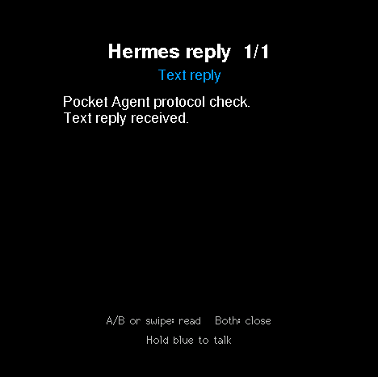
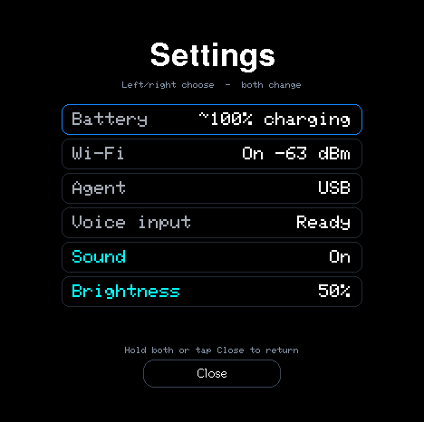
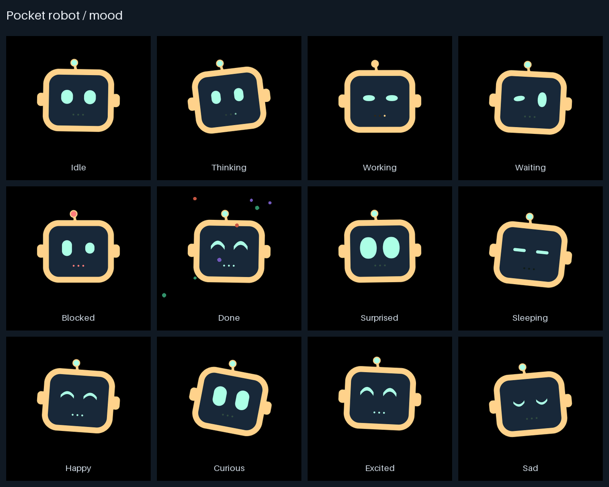

# Pocket Agent

**A little robot you can talk to. A live view of what your agent is doing.**

Pocket Agent puts a voice interface for Hermes on an M5Stack C152 badge. Hold the blue button to speak, release to send, and read the reply on the badge. One animated Assistant follows the conversation, with different expressions for thinking, working, waiting and finishing a task.

[Get started](docs/SETUP.md) · [Controls](#controls) · [Development](docs/DEVELOPMENT.md) · [Behavior reference](docs/reference/SPEC.md)

|                                        Your Assistant                                        |                                           Text replies                                           |                                                      Settings                                                       |
| :------------------------------------------------------------------------------------------: | :----------------------------------------------------------------------------------------------: | :-----------------------------------------------------------------------------------------------------------------: |
|  |  |  |

_Actual 468 × 466 framebuffer screenshots from the C152. The reply is a synthetic protocol-test message. See [image sources](docs/images/README.md)._

## What it does

- Talk to Hermes with push-to-talk voice input. Each command continues the same private badge conversation, including after a host restart.
- See when the Assistant is thinking, using a tool, waiting for you or done. The original robot has 12 animated moods and 25 eye expressions, plus blinking, bounce and touch interaction.
- Read final replies on the badge and page through longer answers with the buttons or a swipe. Answer clarifications by voice; say `approve once` or `deny` when Hermes offers those choices.
- Use USB at your desk or local Wi-Fi away from the cable. USB takes priority, with authenticated Wi-Fi on standby.
- Check battery, connection and voice readiness in Settings, and adjust sound and brightness on the badge.

Speech recognition runs locally on the Mac. Hermes uses the model, tools and provider configured in your existing Hermes installation. Replies on the badge are text only. The Mac must stay awake and reachable.

## How it works

```text
C152 badge  ← USB or local Wi-Fi →  Mac bridge  ↔  Hermes conversation
 microphone                         local speech     model + tools
 robot + text replies               recognition
```

The badge records while you hold the button. The Mac transcribes the recording and submits it to the badge's Hermes conversation. Activity updates animate the robot; the final answer returns as paged text. Voice recordings and reply text use encrypted channels between the badge and Mac. Short status and activity updates are authenticated but unencrypted on the local network.

## Get started

You'll need:

- An M5Stack C152 badge and a USB connection for initial pairing.
- A nearby Mac with Node.js 26 and a configured Hermes installation.
- Faster-Whisper in the Hermes Python environment and a downloaded local Whisper model.
- A reachable 2.4 GHz Wi-Fi network if you want to unplug USB.

1. Follow [Setup](docs/SETUP.md#connect-hermes) to start the badge conversation and bridge.
2. Connect the badge over USB to pair automatically, then [provision Wi-Fi](docs/SETUP.md#pair-usb-and-wi-fi) if needed.
3. Hold the blue/right button for at least 600 ms, speak, and release to send.

If the badge already has Pocket Agent firmware, skip the firmware section. For a fresh badge or an update, follow the [firmware instructions](docs/SETUP.md#firmware-only-for-an-unflashed-badge-or-an-update). You can also [start the host at login](docs/SETUP.md#start-at-login-optional).

## Controls

With the lanyard pointing down, BtnA is left and the blue BtnB is right.

| Action                          | Control                                        |
| ------------------------------- | ---------------------------------------------- |
| Record a voice command          | Hold blue/right for 600 ms; release to submit. |
| Acknowledge the Assistant       | Short left or right press.                     |
| Page through a reply            | Press left/right or swipe.                     |
| Close a reply                   | Press both buttons briefly.                    |
| Open Settings                   | Tap the gear or hold left for 600 ms.          |
| Choose a setting                | Tap its row or press left/right.               |
| Change sound or brightness      | Tap the selected row or press both briefly.    |
| Close Settings                  | Tap Close or hold both for 600 ms.             |
| Sleep or wake, outside Settings | Hold both for 600 ms.                          |

## One robot, many moods

The Assistant uses one original design, defined in [robot_art.py](tools/assets/robot_art.py). Its eyes, antenna and motion change with the task. With no Assistant connected, the badge cycles through a screensaver using the same robot.



_Avatar crops rendered from the firmware on the host with substitute display, clock and input hardware. These are artwork previews; they do not measure device performance._

## Work on Pocket Agent

Start with [Development](docs/DEVELOPMENT.md) for tools, tests and device verification.

| Location                                           | Contents                                                         |
| -------------------------------------------------- | ---------------------------------------------------------------- |
| [`firmware/pocket_agent/`](firmware/pocket_agent/) | C152 application, robot rendering, controls, voice and reply UI. |
| [`host/hermes/`](host/hermes/)                     | Hermes conversation, speech recognition and reply delivery.      |
| [`host/bridge/`](host/bridge/)                     | USB/Wi-Fi hub, pairing and CLI.                                  |
| [`tools/assets/`](tools/assets/)                   | Original robot artwork and firmware asset generation.            |
| [`tests/`](tests/)                                 | Portable model, protocol, renderer and device checks.            |

Generated assets, dependencies, models, runtime state and raw captures stay in ignored `.build/`. Selected, reviewed README images live in [`docs/images/`](docs/images/README.md).

With the development dependencies already installed:

```sh
make format
make test check-format check-js check-python check-public
```

For behavior and transport details, see the [specification](docs/reference/SPEC.md). For connection problems, see [troubleshooting](docs/SETUP.md#troubleshooting-and-configuration).

## License

Pocket Agent is available under the [MIT License](LICENSE). Dependencies retain their own licenses.
